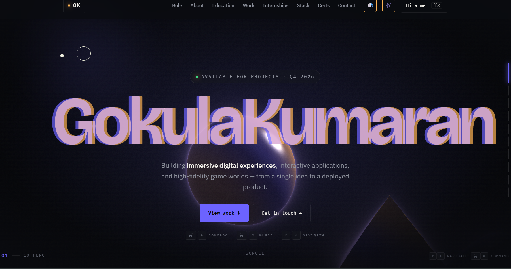

# Gokula Kumaran — Cinematic Sci-Fi Scroll-Story Portfolio (v4.0)

> **An interactive scroll-story portfolio combining a real-time WebGL background shader, procedural Web Audio API sound synthesis, custom difference-blend cursor physics, and a command palette—all in zero-framework vanilla HTML, CSS, and JavaScript.**  
> 🌐 **Live Demo**: [https://gokulakumarans4.netlify.app/](https://gokulakumarans4.netlify.app/)



---

## ✨ Overview

**Portfolio v4.0** transforms the developer portfolio into an atmospheric **scroll-driven story**. Built cleanly without external frameworks or runtime libraries, it layers a procedural **WebGL background canvas (`#shader-bg`)**, an **SVG fractal-noise film grain overlay**, dynamic **per-section radial color tinting**, and a **real-time Web Audio synthesizer (`window.SoundFX`)** that generates ambient space music and 11 distinct UI sound effects directly in the browser.

---

## ⚙️ Core Mechanisms, Functions & Methods

### 1. Multi-Layered Atmospheric Rendering Pipeline
- **`#shader-bg` (WebGL Background Canvas)**: Renders a procedural cosmic backdrop behind the UI, fading in smoothly via `#shader-bg.ready` (`opacity: 1`).
- **`.vignette` & `.grain` Overlays**:
  - `.vignette` applies a fixed radial-gradient edge darkening (`transparent 20% → #0A0B0F 90%`).
  - `.grain` composites an inline SVG `<feTurbulence type="fractalNoise" baseFrequency="0.9" numOctaves="3"/>` texture at `mix-blend-mode: overlay` for tactile cinema grain.
- **`.section-tint` & `.cursor-glow`**:
  - Tracks pointer coordinates to move a `500×500px` blurred (`filter: blur(30px)`) radial glow (`mix-blend-mode: screen`) that expands to `700×700px` warm amber (`#FFB454`) when hovering interactive targets (`.cursor-glow.boost`).
  - Smoothly shifts the full-screen `--tint-color` as the user transitions between story chapters.

### 2. Procedural Web Audio Sound Engine (`window.SoundFX`)
Synthesizes all audio live via the browser's native `AudioContext`—requiring **zero external `.mp3`/`.wav` dependencies**:
- **Generative Space Music & Harmonic Space Pings (`startMusic()`, `playSpacePing()`, `scheduleSpacePing()`)**:
  - Builds a continuous ambient pad routed through a `ConvolverNode` reverb stage.
  - Every `4–13 seconds` (intentionally irregular via `scheduleSpacePing()`), fires a sine wave harmonic ping chosen from a pentatonic frequency array (`[880, 987.77, 1174.66, 1318.51, 1567.98]` Hz), stereo-panned randomly across the soundstage (`StereoPannerNode`) with a `3.5s` exponential decay tail.
- **11 Real-Time UI SFX Presets (`SOUND_PRESETS` & `play(type)`)**:
  - Synthesizes `click`, `pop`, `hover`, `type`, `success`, `error`, `swoosh`, `open`, `close`, `whoosh`, and `click_soft` using frequency-swept oscillators (`sine`, `triangle`, `square`, `sawtooth`) and optional low-pass `BiquadFilterNode` shaping (`lp: 3500`).
- **Tactile Typing Feedback (`handleType(e)`)**:
  - Listens for keystrokes inside `<input>` and `<textarea>` fields, throttling playback (`TYPE_THROTTLE = 50ms`) and alternating randomly between `'type'` and `'click_soft'` mechanical synth clicks.

### 3. Difference-Blend Cursor, Click Ripples & Particle Bursts
- **`.cursor-dot` (`10×10px`) & `.cursor-ring` (`40×40px`)**: Rendered with `mix-blend-mode: difference` so the cursor automatically inverts against both dark and light typography, expanding to `64×64px` (`--accent: #6C63FF`) on hover.
- **Click Ripples (`.click-ripple`) & Particles (`.particle`)**: Clicking anywhere spawns an expanding `80×80px` shockwave ring alongside radial particle bursts animated with cubic-bezier decay (`cubic-bezier(0.16, 1, 0.3, 1)`).

### 4. Interactive Navigation, Command Palette & Easter Eggs
- **Section Progress Rail (`.section-progress`)**: Slim vertical left-hand progress gauge driven by `--sec-progress` and paired with a top horizontal tri-gradient `.scroll-progress` bar (`#6C63FF → #FFB454 → #00E5FF`).
- **Command Palette (`⌘K` / `Ctrl+K`)**: Instant keyboard launcher to jump to sections, toggle audio/BGM, or trigger hidden commands.
- **Konami Code & Secret Overlay**: Entering `↑ ↑ ↓ ↓ ← → ← → B A` (or typing `"secret"` into the `⌘K` command box) unlocks a hidden message and developer favorites overlay.
- **3D Tilt & Animated Metric Counters (`initTilt()`, `initReveals()`)**:
  - Cards respond to pointer movement with perspective 3D tilt.
  - `.metric-num[data-count]` and `.hero-stat-num[data-count]` count up over 50 `requestAnimationFrame` ticks once scrolled into view (`threshold: 0.5`).
- **Smart Inquiry Builder (`prefillMessage()`, `buildMailto()`, `handleSubmit()`)**:
  - Constructs a pre-formatted `mailto:` URI encoding the sender's name, email, selected service category, and message body with audio confirmation (`play('swoosh')` → `play('success')`).

---

## 🎨 Design System Tokens

| Variable | Value | Role |
| :--- | :--- | :--- |
| `--bg` / `--surface-solid` | `#0A0B0F` / `#14161B` | Obsidian background & card surfaces |
| `--text` / `--text-muted` | `#F3F1EA` / `#9195A0` | Warm ivory display ink & muted metadata |
| `--accent` | `#6C63FF` | Primary electric violet interactive accent |
| `--accent-2` | `#FFB454` | Solar amber secondary focal highlight |
| `--accent-3` | `#00E5FF` | Cyber cyan telemetry & gradient stop |
| `--status` | `#3DDC84` | Emerald availability & form confirmation |
| `--font-display` | `'Bricolage Grotesque'` | Expressive geometric headings |
| `--font-body` / `--font-mono` | `'IBM Plex Sans'` / `'IBM Plex Mono'` | Technical prose & HUD readouts |

---

## 📂 Repository Structure

```text
My portfolio 4.0/
├── index.html                      # Primary production Scroll-Story Portfolio
├── argon gemini.html               # Experimental variant build (Argon iteration)
├── gemini 3.5 falsh lite.html      # Lightweight experimental variant build
├── style.css                       # External stylesheet placeholder (styles inline in HTML)
├── images/
│   ├── profile2.jpg                # Developer portrait
│   ├── college.jpg                 # Ramco Institute of Technology
│   ├── school.jpg                  # Higher Secondary School
│   ├── certificates/               # Certification & internship credentials
│   └── projects/                   # Project & portfolio showcase screenshots
├── sounds/                         # Optional audio asset folder
└── videos/                         # Local project video demonstrations
```

---

## ⌨️ Keyboard Shortcuts & Controls

| Shortcut / Gesture | Action |
| :--- | :--- |
| `Ctrl + K` / `⌘ + K` | Open the interactive Command Palette |
| `↑` / `↓` Arrow Keys | Navigate smoothly between story sections |
| `↑ ↑ ↓ ↓ ← → ← → B A` | Unlock the hidden Konami Code Secret Panel |
| `🔊` / `🎶` Header Buttons | Toggle UI Sound Effects (`toggleSound()`) and Ambient Space Music (`toggleMusic()`) |

---

## 🚀 Running Locally

No build tools or `npm install` required:

1. **Direct Launch**: Open `index.html` directly in any modern browser.
2. **Static Server**:
   ```bash
   python -m http.server 8080
   ```

---

## 👤 Author

**Gokula Kumaran S**  
*Game & Full-Stack Developer*  
- **Live Site**: [gokulakumarans4.netlify.app](https://gokulakumarans4.netlify.app/)
- **GitHub**: [@sGokulaKumaran](https://github.com/sGokulaKumaran)
- **LinkedIn**: [gokula-kumaran-s](https://www.linkedin.com/in/gokula-kumaran-s-503545328/)
- **Email**: [gokulakumaran2007@gmail.com](mailto:gokulakumaran2007@gmail.com)
