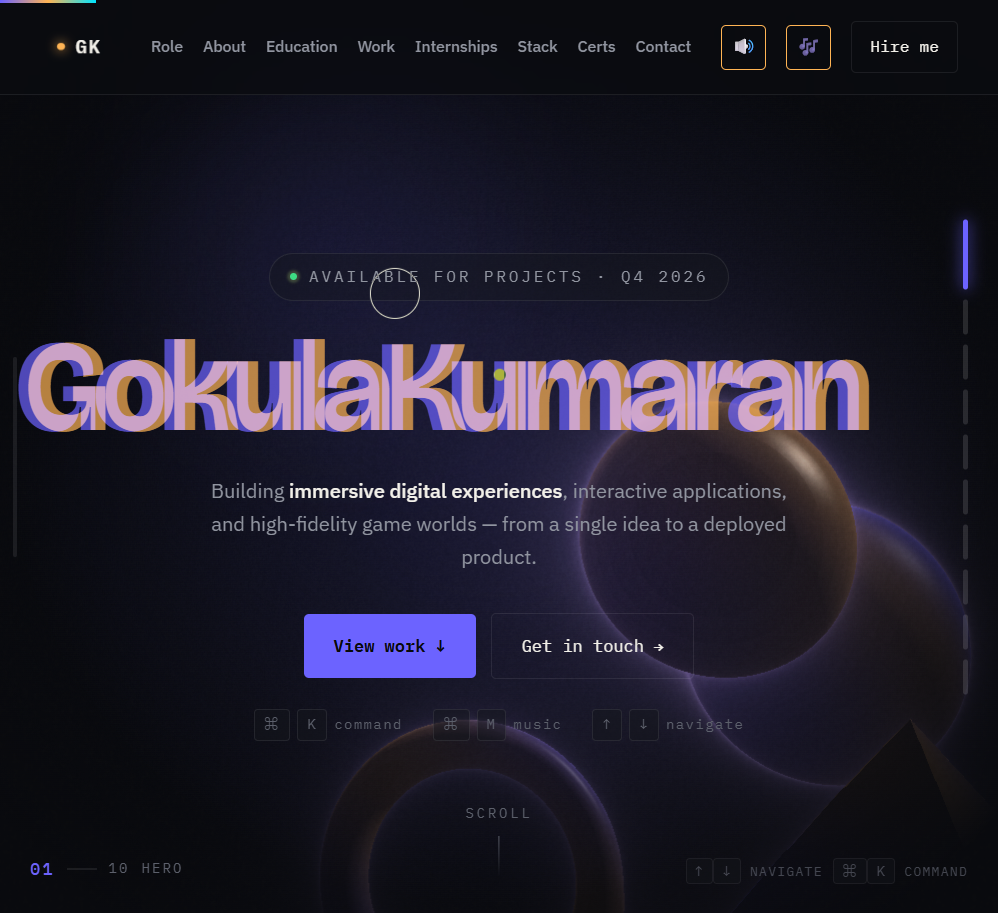
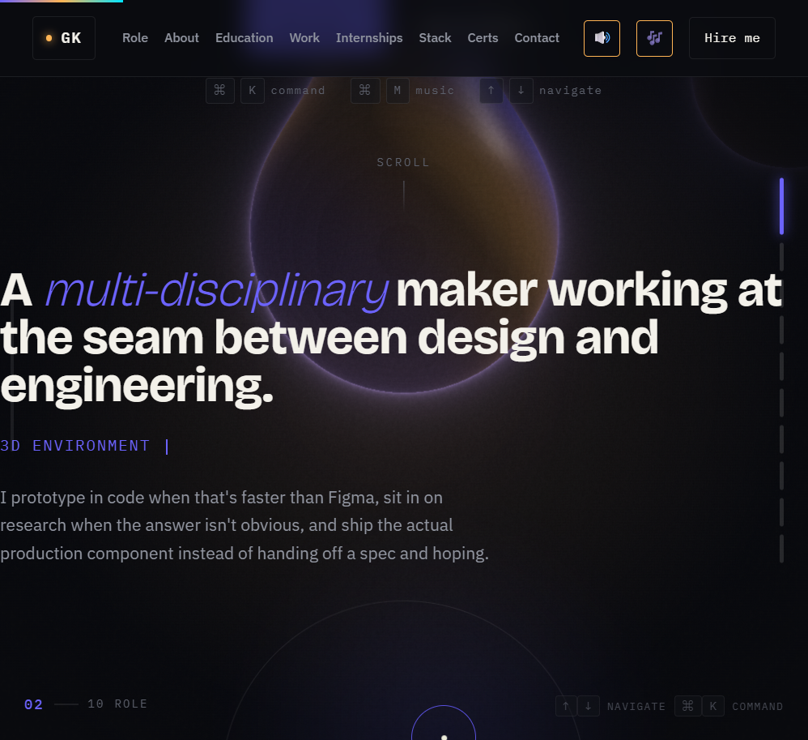
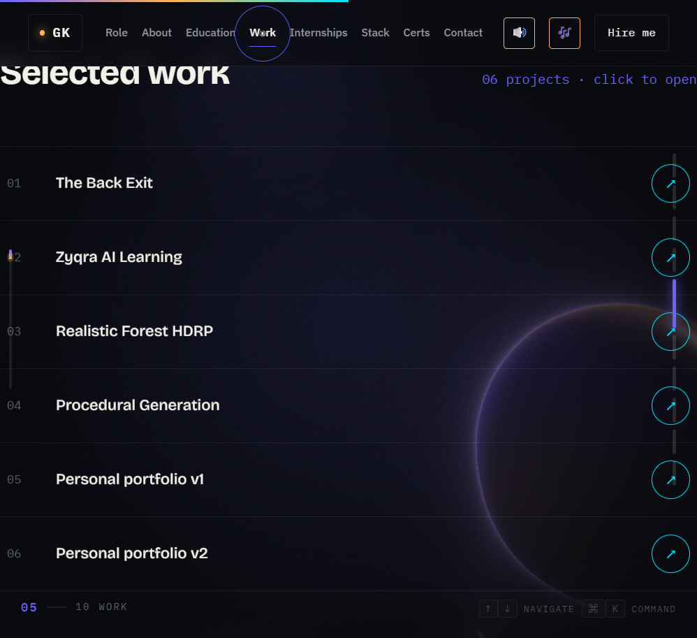
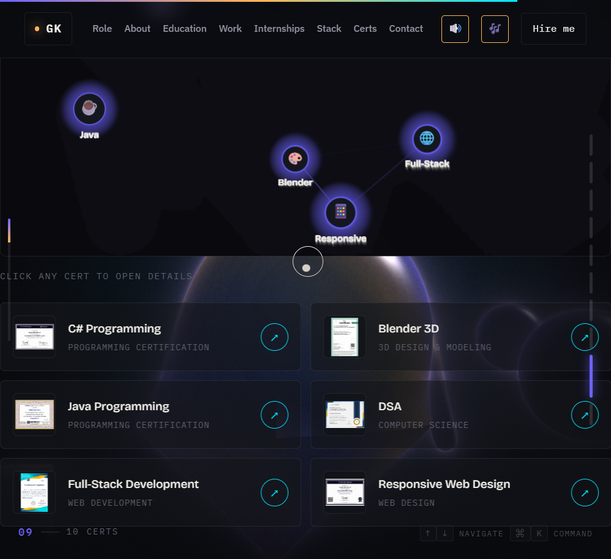
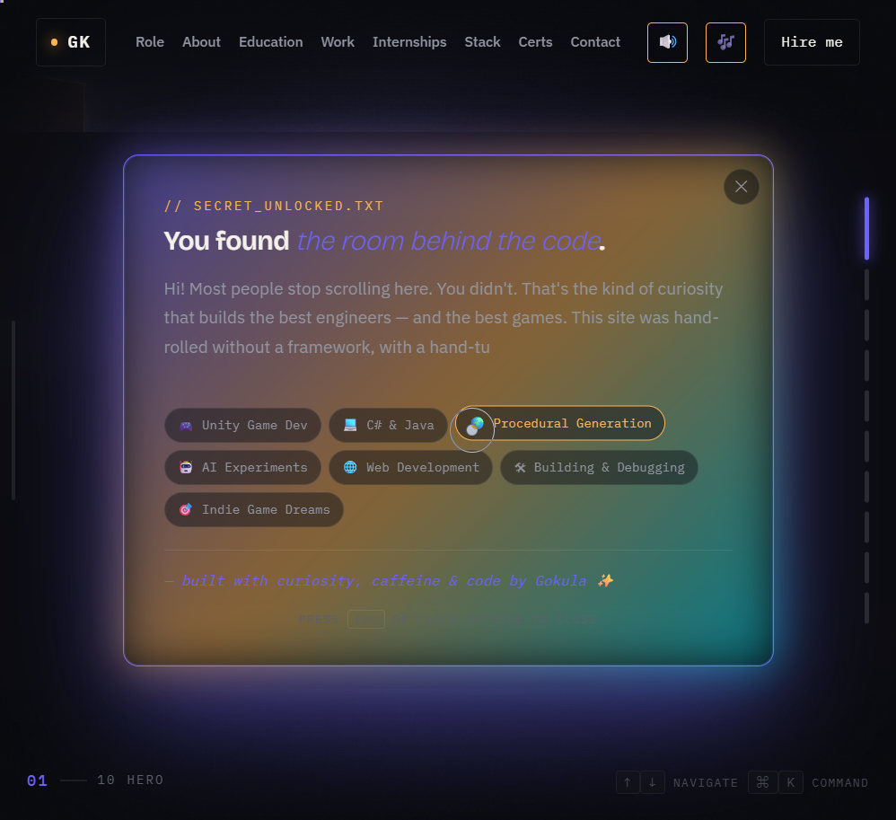

# Gokula Kumaran — Cinematic Sci-Fi Scroll-Story Portfolio (v4.0)

> **An interactive, zero-framework scroll-story portfolio combining a 64-step raymarched WebGL1 3D SDF metaball backdrop, a 5-layer procedural Web Audio space synthesizer, clone-safe infinite scroll, a 27-action command palette, and a Konami-code confetti secret room.**  
> 🌐 **Live Demo**: [https://gokulakumarans4.netlify.app/](https://gokulakumarans4.netlify.app/)



---

## 📚 Modular Documentation Hub

Portfolio v4.0 packs 2,477 lines of custom WebGL shaders, matrix math, Web Audio DSP synthesis, infinite DOM cloning, and physics-driven micro-interactions into a single self-contained file. Its documentation is organized into modular guides:

| Document | What It Covers |
| :--- | :--- |
| 📄 **[`README.md`](README.md)** *(You are here)* | Visual screenshot gallery, the 10 story panels tour, core engines summary, keyboard controls & local setup |
| 🗂️ **[`docs/STRUCTURE.md`](docs/STRUCTURE.md)** | Directory tree, monolithic 3-layer `index.html` anatomy, z-index ladder (`0 → 100001`), DOM map & script execution layout |
| 🧠 **[`docs/CONCEPTS.md`](docs/CONCEPTS.md)** | Mathematical & DSP deep-dives: 64-step Raymarching SDFs & polynomial `smin` metaball blending, 3D matrix pipeline, 2D repulsion graph, 5-layer Web Audio void reverb & infinite-scroll index mapping |
| ⚙️ **[`docs/MECHANISMS.md`](docs/MECHANISMS.md)** | Function-by-function & feature guide: `SmoothScroll`, difference-blend cursor/glow, split-letter physics, 3-tier fallback modal, 27-action `⌘K` palette, Konami confetti room & `window.SoundFX` presets |

---

## 🖼️ Visual Gallery & Interactive Highlights

### 1. Hero (`#p0`) & Role 3D WebGL Cube (`#p1`)
In **Panel 01 (`#p0`)**, mouse-reactive split typography (`Gokula`) pairs with dual screen-blend RGB glitch layers over a live **64-step raymarched 3D SDF metaball shader** (`#shader-bg`). Scrolling to **Panel 02 (`#p1`)** reveals a cyclic typewriter role ticker alongside an interactive **WebGL1 3D rotating cube (`#roleCanvas`)** lit by an orbiting directional light.

| Panel 01 · Hero & Raymarched SDF Backdrop | Panel 02 · Role Typewriter & 3D WebGL Cube |
| :---: | :---: |
|  |  |

### 2. Selected Work (`#p3`) & Certifications Constellation (`#p5`)
**Panel 05 (`#p3`)** showcases 6 interactive `.work-row` entries with 3D perspective card tilt and cyan media indicators. **Panel 09 (`#p5`)** renders an interactive **2D force-repulsion constellation graph (`#certsCanvas`)** where certificate nodes drift, repel away from your cursor, and weave proximity links above the 6 credential cards.

| Panel 05 · Selected Work (`06 projects`) | Panel 09 · Certifications Constellation (`#certsCanvas`) |
| :---: | :---: |
|  |  |

### 3. Fuzzy Command Palette (`⌘K`) & Konami Secret Room (`#secretOverlay`)
Pressing `⌘K` / `Ctrl+K` launches a **27-action fuzzy command palette** for jumping to sections, opening projects/certs, toggling sound/music, or unlocking secrets. Entering the **Konami Code (`↑↑↓↓←→←→BA`)** unleashes **70 Web Animations confetti pieces** and streams a typewriter note inside the hidden room behind the code.

| 27-Action Command Palette (`⌘K`) | Konami Code Secret Room (`// secret_unlocked.txt`) |
| :---: | :---: |
|  |  |

*Additional project showcase capture available at [`images/projects/portfoliov4.png`](images/projects/portfoliov4.png).*

---

## 🎬 The 10 Story Panels Tour (`PANEL_IDS`)

Each section in `<main class="story" id="story">` enters from a choreographed `data-from` direction and shifts the global ambient atmosphere via `data-tint`:

| # | Panel ID | Label | `data-from` | `data-tint` | Interactive Features |
| :---: | :--- | :--- | :--- | :--- | :--- |
| `01` | `#p0` | **Hero** | `scale` | `rgba(108, 99, 255, 0.15)` | Split-character mouse-repulsion typography + RGB screen-blend glitch + magnetic CTAs |
| `02` | `#p1` | **Role** | `right` | `rgba(255, 180, 84, 0.1)` | Cyclic typewriter ticker (`6` developer roles) + WebGL1 3D lit rotating cube (`#roleCanvas`) |
| `03` | `#p2` | **About** | `left` | `rgba(0, 229, 255, 0.08)` | 3D-tilted portrait card with rotating `GK` float badge & hoverable skill pills |
| `04` | `#p2-edu` | **Education** | `bottom` | `rgba(0, 229, 255, 0.08)` | School & B.Tech (Ramco Institute of Technology) cards opening media detail modals |
| `05` | `#p3` | **Work** | `bottom` | `rgba(108, 99, 255, 0.12)` | 6 `.work-row` entries launching video/image/art briefing modals |
| `06` | `#p3-5` | **Stats** | `scale` | `rgba(61, 220, 132, 0.08)` | 4 animated counters (`6+`, `6+`, `2+`, `100%`) counting over 50 `rAF` frames |
| `07` | `#p3-intern` | **Internships** | `right` | `rgba(255, 180, 84, 0.1)` | *Skiez Digital* (Python Full-Stack) & *Playxoft Studios* (Unity Game Dev) credential modals |
| `08` | `#p4` | **Stack** | `left` | `rgba(108, 99, 255, 0.1)` | 4 discipline `.service-item.tilt` cards with sliding dual-accent underline bars |
| `09` | `#p5` | **Certs** | `right` | `rgba(0, 229, 255, 0.08)` | Clone-safe 2D force-repulsion constellation canvas (`#certsCanvas`) + 6 `.cert-card` items |
| `10` | `#p6` | **Contact** | `bottom` | `rgba(255, 180, 84, 0.12)` | Smart `mailto:` inquiry builder (`buildMailto()`, `handleSubmit()`) + magnetic social pills |
| `∞` | `#infiniteSentinel` | **Infinite Loop** | — | — | Automatically clones all 10 panels (`clonePanels()`) & re-hydrates listeners/canvases seamlessly |

---

## ⚙️ Core Engines Summary

> *Explore the full mathematical formulas and function references in **[`docs/CONCEPTS.md`](docs/CONCEPTS.md)** and **[`docs/MECHANISMS.md`](docs/MECHANISMS.md)**.*

- **64-Step Raymarched 3D SDF Shader (`#shader-bg`)**: Combines an octahedron, orbiting spheres, torus, box, and cursor-tracked orb using polynomial smooth minimum (`smin`) so shapes melt organically like liquid metal in real time.
- **5-Layer Procedural Web Audio Synth (`window.SoundFX`)**: Generates an 8-second stereo convolver reverb void, 32Hz sub-bass rumble, LFO-swept solar wind bandpass noise, 4 detuned dual-oscillator drones, 4 shimmer pads, and random pentatonic pulsar pings (`880Hz–1567.98Hz`), plus **11 UI SFX presets** and `50ms`-throttled mechanical typing sounds.
- **Difference-Blend Cursor, Glow & Particle Physics**: Combines a 18%-lerped `mix-blend-mode: difference` cursor (`#cursorDot`/`#cursorRing`), a 12%-lerped `blur(30px)` screen-blend `#cursorGlow` that boosts on interactive elements, expanding `.click-ripple` rings, and 4-color radial particle bursts.
- **Clone-Safe Infinite Scroll (`clonePanels`)**: Clones all 10 panels endlessly at `#infiniteSentinel`, re-assigns unique `#certsCanvas-N` IDs, and tracks canonical `data-base` indices so the `01 — 10` counter and section progress bar stay accurate across infinite loops.
- **3-Tier Resilient Media Modal (`openModal`)**: Plays project `.mp4` videos with automatic error fallback to project images or 12 custom themed gradient art canvases (`.horror`, `.ai`, `.forest`, `.shader`, etc.).

---

## ⌨️ Keyboard Shortcuts & Gestures

| Shortcut / Gesture | Action |
| :--- | :--- |
| `Ctrl + K` / `⌘ + K` | Open or close the **27-Action Fuzzy Command Palette** |
| `Ctrl + M` / `⌘ + M` | Toggle the 5-layer **Ambient Space Synthesizer** on/off |
| `↑` / `↓` / `J` / `K` / `PageUp` / `PageDown` | Smoothly scroll (`1400ms` cubic tween) to previous/next story panel |
| `Home` / `End` | Jump directly to Panel `01` (`#p0`) or Panel `10` (`#p6`) |
| **Vertical Touch Swipe** | Navigate panels on mobile with `#swipeFlashUp` / `#swipeFlashDown` feedback |
| `↑ ↑ ↓ ↓ ← → ← → B A` | Unlock the **Konami Secret Room** with 70 confetti pieces & typewriter log |

---

## 📂 Files & Experimental Variants

| File | Description |
| :--- | :--- |
| [`index.html`](index.html) | Primary 2,477-line production Scroll-Story Portfolio |
| [`gemini 3.5 falsh lite.html`](gemini%203.5%20falsh%20lite.html) | Lightweight 779-line experimental build with Dark/Light `[data-theme]` toggle |
| [`argon gemini.html`](argon%20gemini.html) | Earlier design & SPA enhancement reference log |
| [`style.css`](style.css) | External stylesheet placeholder (production CSS is inlined inside `<head>` for zero-request loading) |

---

## 🚀 Running Locally

No build tools, bundlers, or `npm install` needed:

1. **Direct Open (`file://`)**: Double-click [`index.html`](index.html) to launch immediately in any modern browser.
2. **Local Static Server (Recommended for local video/asset testing)**:
   ```bash
   python -m http.server 8080
   # Open http://localhost:8080
   ```

---

## 👤 Author

**Gokula Kumaran S**  
*Game & Full-Stack Developer — Tamil Nadu, India*  
- **Live Site (v4.0)**: [https://gokulakumarans4.netlify.app/](https://gokulakumarans4.netlify.app/)
- **GitHub**: [@sGokulaKumaran](https://github.com/sGokulaKumaran)
- **LinkedIn**: [gokula-kumaran-s](https://www.linkedin.com/in/gokula-kumaran-s-503545328/)
- **Instagram**: [@goku_1._38](https://www.instagram.com/goku_1._38)
- **Email**: [gokulakumaran2007@gmail.com](mailto:gokulakumaran2007@gmail.com)
