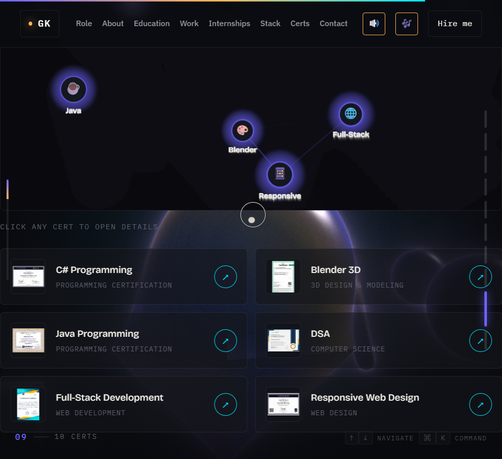
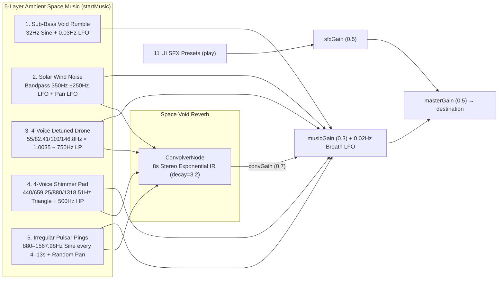

# Portfolio v4.0 — Engineering, Graphics & Mathematical Concepts

> **A deep-dive into the 64-step Raymarched 3D Signed Distance Field (SDF) shader, custom 3D WebGL matrix pipeline, 2D force-repulsion constellation graph, 5-layer procedural Web Audio synthesizer, and clone-safe infinite scroll geometry powering Portfolio v4.0.**

📚 **Documentation Navigation**:
- [← Back to Main README](../README.md)
- [File & Architecture Structure (`docs/STRUCTURE.md`)](STRUCTURE.md)
- [Interactive Mechanisms, Functions & Methods (`docs/MECHANISMS.md`)](MECHANISMS.md)

---

## 1. 64-Step Raymarched 3D Signed Distance Field & Smooth Minimum (`#shader-bg`)

Rather than loading external `.glb` 3D meshes or Three.js, Portfolio v4.0's permanent background (`<canvas id="shader-bg">`, lines 1125–1222) renders an animated 3D world on a single 2D WebGL1 quad (`[-1, 1]`) via **Sphere Tracing (Raymarching)**.


### Exact Signed Distance Primitives (`fsSrc`)
Every geometric body in the scene is defined analytically by a continuous Signed Distance Function $d(\vec{p})$ returning the shortest Euclidean distance from ray position $\vec{p} \in \mathbb{R}^3$ to the surface:

- **Sphere (`sdSphere`)**:
  $$d_{\text{sphere}}(\vec{p}, r) = \|\vec{p}\| - r$$
- **Torus (`sdTorus`)**:
  $$d_{\text{torus}}(\vec{p}, \vec{t}) = \left\|\left(\|\vec{p}_{xz}\| - t_x,\; p_y\right)\right\| - t_y$$
- **Box (`sdBox`)**:
  $$\vec{q} = |\vec{p}| - \vec{b}, \quad d_{\text{box}}(\vec{p}, \vec{b}) = \|\max(\vec{q}, 0)\| + \min\left(\max(q_x, \max(q_y, q_z)),\; 0\right)$$
- **Octahedron (`sdOctahedron`)**:
  $$d_{\text{oct}}(\vec{p}, s) = \left(|p_x| + |p_y| + |p_z| - s\right) \cdot \frac{1}{\sqrt{3}} \approx \left(|p_x| + |p_y| + |p_z| - s\right) \cdot 0.57735027$$

### Polynomial Smooth Minimum (`smin`) — Organic Metaball Melting
To blend rigid geometric shapes (a central octahedron `d1`, two orbiting spheres `d2`/`d3`, a rotating torus `d4`, a rotating box `d5`, and an interactive cursor-tracked sphere `dm` at `(uMouse.x * 5.0, uMouse.y * 3.0, 0.0)`) into liquid metaballs, `map(vec3 p)` chains **polynomial smooth minimum**:

```glsl
float smin(float a, float b, float k) {
  float h = clamp(0.5 + 0.5 * (b - a) / k, 0.0, 1.0);
  return mix(b, a, h) - k * h * (1.0 - h);
}
```

$$h = \text{clamp}\left(0.5 + \frac{0.5(b - a)}{k},\; 0,\; 1\right), \quad \text{smin}(a, b, k) = \text{mix}(b, a, h) - k \cdot h(1 - h)$$

As the user scrolls (`uScroll = window.scrollY * 0.001`) or moves the pointer (`uMouse` smoothed at 6% per frame), the phase `t = uTime * 0.3 + uScroll * 3.0` rotates the global field and blends the cursor orb seamlessly into surrounding shapes with blending radius $k = 1.0$.

### Sphere-Tracing Loop, Finite-Difference Normals & Glow
1. **Marching (`i = 0..63`)**: Starts rays from origin `ro = (0, 0, -7)` (+ pointer parallax) and steps along direction `rd` using conservative step multiplier `t += d * 0.85` up to `t = 40.0`.
2. **Surface Normals (`calcNormal`)**: When `d < 0.01`, approximates the gradient $\nabla d(\vec{p})$ via 6 central-difference taps with $\epsilon = 0.001$.
3. **Blinn-Phong / Specular + Palette Shading**: Combines two directional diffuse lights (`(1, 1, 0.5)` and `(-0.5, 0.5, 1)`), a 32-exponent specular highlight, violet-to-amber spatial sine coloring (`mix(violet, amber, 0.5 + 0.5*sin(p.x*2 + p.y*2 + p.z*2))`), distance fog (`smoothstep(8.0, 30.0, t)`), and inverse-square near-miss halo glow:
   $$\text{glow} \mathrel{+}= \frac{0.015}{1 + 4d^2}$$
4. **Vignette & White-Noise Dithering**: Multiplies by radial vignette `1.0 - smoothstep(0.4, 1.2, length(uv))` and adds subtle hash noise (`±0.0125`) to prevent 8-bit dark banding.

---

## 2. Custom WebGL1 3D Matrix Pipeline (`#roleCanvas`)

In **Panel 01 · Role** (lines 1225–1265), `<canvas id="roleCanvas">` renders an interactive 3D lit cube without any matrix library:

- **Geometry & Buffers**: Creates an 8-corner `Float32Array` position buffer, matching per-vertex normal vectors `n`, and a 36-index `Uint16Array` triangle mesh (`ELEMENT_ARRAY_BUFFER`) with hardware `gl.DEPTH_TEST`.
- **Manual $4\times 4$ Matrix Multiplication (`mul(perspMat, rot)`)**: Multiplies a perspective projection matrix `perspMat` by a live Y-axis rotation matrix ($\theta = 0.5t$) directly in JavaScript, uploading `uMVP` and model matrix `uM` (`mat4`) to the vertex shader.
- **Orbiting Lighting & Pointer Emissive Glow**: Fragment shading transforms normals into world space (`vN = normalize((m * vec4(n, 0.0)).xyz)`), shades against an orbiting directional light $\vec{L} = \text{normalize}((\sin t, 0.5, \cos t))$, blends violet/amber surface gradients along `vN.y`, and adds pointer-reactive violet glow proportional to `length(m)`.

---

## 3. 2D Force-Repulsion Graph & Proximity Networking (`#certsCanvas`)

In **Panel 08 · Certifications** (lines 1268–1361), `startCertsCanvas(canvas)` simulates an interactive 6-node constellation graph:



1. **Autonomous Drift & Wall Bounce**: Each node (`C#`, `Blender`, `Java`, `DSA`, `Full-Stack`, `Responsive`) drifts with velocity `(vx, vy) ∈ [-0.15, +0.15]` px/frame, reversing velocity cleanly at a `40px` margin from canvas borders.
2. **Radial Pointer Repulsion**: When the cursor hovers inside the canvas (`mouse.active === true`), any node within `d < 150px` experiences an outward unit-vector push:
   $$\vec{p} \mathrel{-}= \frac{\vec{\Delta}}{\|\vec{\Delta}\|} \cdot 0.5$$
3. **Pairwise Proximity Edges ($O(N^2)$)**: Connects every pair of nodes within `180px` using opacity scaled inversely with distance:
   $$\alpha = \left(1 - \frac{d}{180}\right) \cdot 0.4$$
4. **Motion-Trail Persistence & Breathing Nodes**: Uses `rgba(10, 11, 15, 0.18)` partial-clear rectangles each frame for soft motion trails, while node radii pulse sinusoidally ($r = 20 + 3\sin(2t + 10x)$).

---

## 4. 5-Layer Procedural Web Audio API Space Synthesizer (`window.SoundFX`)

Portfolio v4.0 loads **zero `.mp3`, `.wav`, or `.ogg` audio files**. Every sound effect and the entire evolving ambient space score are synthesized live via Web Audio nodes (lines 2122–2377):



### DSP Implementation Details
1. **Algorithmic 8-Second Space Impulse Response (`createSpaceImpulseResponse(ctx, 8, 3.2)`)**:
   Generates a stereo buffer of length `8 * sampleRate` filled with white noise shaped by an exponential power decay envelope:
   $$\text{IR}[i] = \left(2 \cdot \text{rand}() - 1\right) \cdot \left(1 - \frac{i}{N}\right)^{3.2}$$
2. **Binaural Detuning on Drone Voices**: Each drone fundamental (`55`, `82.41`, `110`, `146.8` Hz) pairs two sine oscillators at `freq` and `freq * 1.0035`, creating a slow organic phase-beating texture panned alternatingly at `-0.3` and `+0.3`.
3. **Pentatonic Pulsar Beacons (`playSpacePing()` & `scheduleSpacePing()`)**: Recursively schedules irregular timers (`4000 + Math.random() * 9000` ms) that trigger randomly panned (`[-1, +1]`), 3.5-second decaying sine pings from `[880, 987.77, 1174.66, 1318.51, 1567.98]` Hz directly into the 8-second convolver void.

---

## 5. Infinite-Scroll DOM Cloning & Canonical Index Mapping

When the visitor scrolls within `800px` of `#infiniteSentinel` at the bottom of the page (lines 2074–2120), `clonePanels(suffix)` duplicates all 10 original panels (`.panel:not(.cloned)`) into an endless loop while keeping all UI state accurate:

1. **ID & Attribute Sanitization**: Assigns unique IDs (`panel.id + '-' + suffix`), tags each clone with `data-base="<originalId>"`, reassigns `#certsCanvas` to `certsCanvas-<N>` without `data-certs-init`, and strips stale `data-listener`, `data-tilt-init`, and `.revealed` markers.
2. **Re-Hydration**: Immediately re-runs `attachCardListeners()`, `initTilt()`, `initReveals()`, and `initAllCertsCanvases()` on the new DOM subtree.
3. **Clone-Safe Progress Mapping (`getPanelMap()` & `findOriginalIndexInMap()`)**: Computes fresh `getBoundingClientRect().top + window.scrollY` positions on scroll (never caching stale heights) and reads `el.dataset.base || el.id` so `#scNum` (`01`..`10`), `#scLabel` (`Hero`..`Contact`), and the vertical `--sec-progress` bar cycle cleanly across infinite loops.
