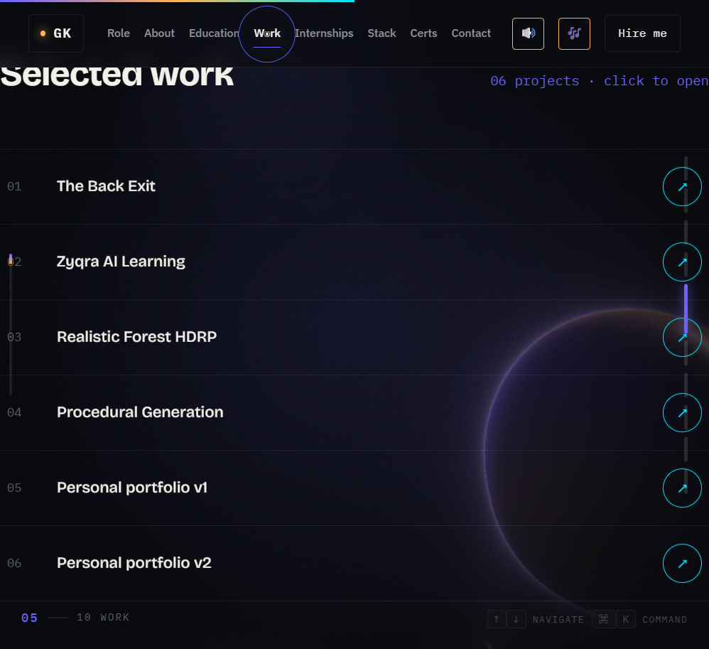
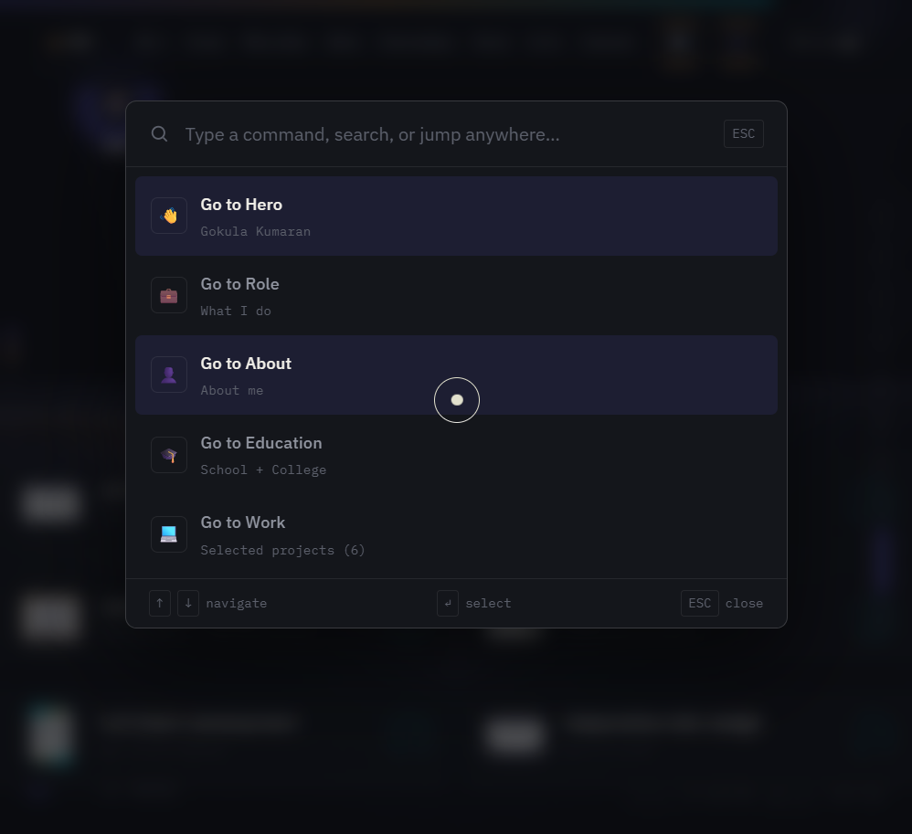
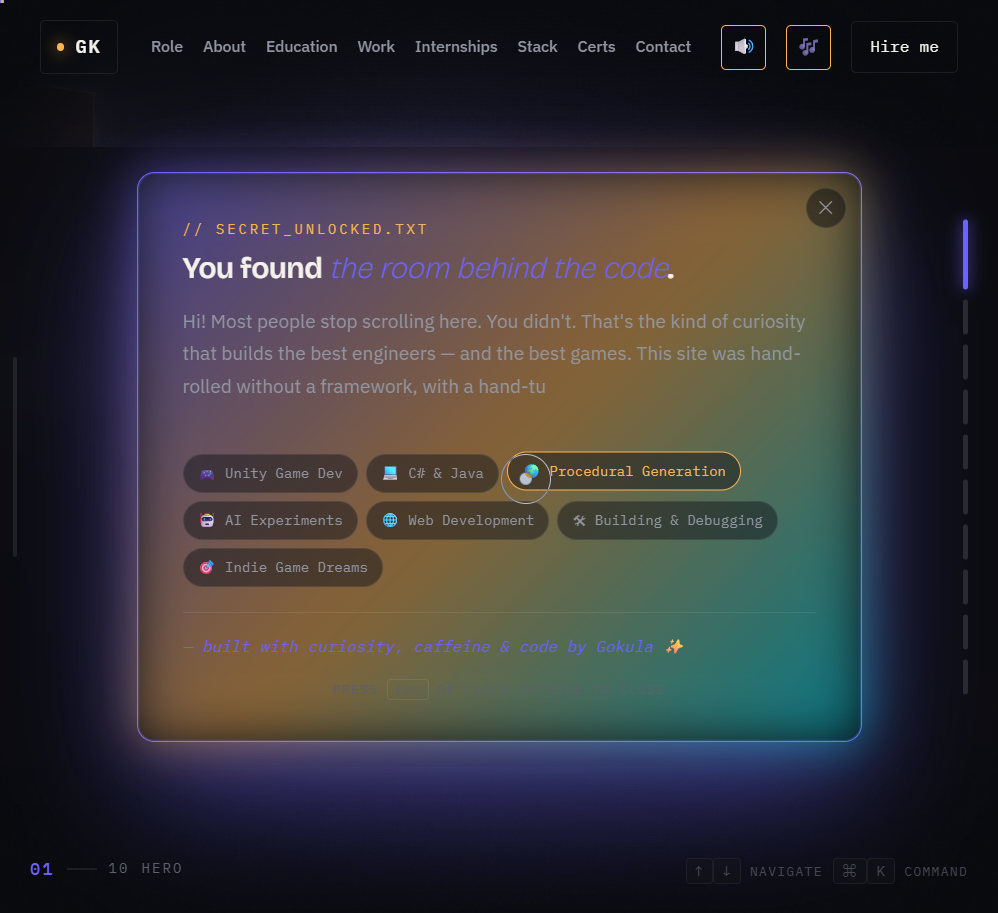

# Portfolio v4.0 — Interactive Mechanisms, Functions & Methods Reference

> **A complete engineering guide documenting every JavaScript object, function, event listener, UI overlay, and protective mechanism inside Portfolio v4.0 (`index.html`).**

📚 **Documentation Navigation**:
- [← Back to Main README](../README.md)
- [File & Architecture Structure (`docs/STRUCTURE.md`)](STRUCTURE.md)
- [Engineering & Mathematical Concepts (`docs/CONCEPTS.md`)](CONCEPTS.md)

---

## 1. Navigation & Scroll Systems

| Symbol | Signature | Behavior & Implementation Details |
| :--- | :--- | :--- |
| **`SmoothScroll`** | `.to(targetY)`, `.cancel()`, `._tick()`, `.easeInOutCubic(t)` | **Cancellable Cubic Tween (`1400ms`)**: Smoothly animates `window.scrollTo` along a symmetric cubic curve ($4t^3$ / $1 - \frac{(-2t+2)^3}{2}$). Automatically cancels (`SmoothScroll.cancel()`) on any physical `wheel`, `touchstart`, or non-arrow `keydown` event so user input always wins. |
| **`navTo(id)`** | `navTo('p3')` | Resolves any panel ID, computes `el.getBoundingClientRect().top + window.scrollY - 40`, and launches `SmoothScroll.to(target)`. Intercepts all `a[href^="#"]` clicks and closes `#navMobile`. |
| **`getCurrentPanel()` & `navByDir(dir)`** | `navByDir(1 \| -1)` | Finds the closest panel in `PANEL_IDS` (`['p0', 'p1', 'p2', 'p2-edu', 'p3', 'p3-5', 'p3-intern', 'p4', 'p5', 'p6']`) to `window.scrollY`, plays `'whoosh'`, and glides to the previous/next section (`↑`/`↓`, `J`/`K`, `PageUp`/`PageDown`, `Home`/`End`). |
| **Touch Swipe Recognizer** | `touchstart` / `touchend` + `showSwipeHint(dir)` | Detects vertical swipes (`|dy| > 80px`, `|dy| > 1.5·|dx|`, `dt < 600ms`), jumps sections via `navByDir`, and briefly flashes `#swipeFlashUp` / `#swipeFlashDown` for `1000ms`. |
| **`getPanelMap()` & `updateSectionProgress()`** | Called on `scroll` & `resize` | Recomputes live vertical spans across both original and infinite-cloned `.panel` nodes, updates `#scNum` (`01..10`) + `#scLabel`, and sets `--sec-progress` (`0%..100%`) on the left vertical rail. |

---

## 2. Visual, Cursor & Pointer Physics

### Difference-Blend Dual Cursor & Ambient Glow
- **`.cursor-dot` (`10×10px`) & `.cursor-ring` (`40×40px`)** (lines 1844–1864): Rendered with `mix-blend-mode: difference` so they remain crisp over both dark backgrounds and bright typography. The ring follows at an **18% per-frame lerp** (`ringLoop()`), expanding to `64×64px` (`--accent: #6C63FF`) over interactive selectors.
- **`#cursorGlow` (`glowLoop()`, lines 1488–1507)**: A `500×500px` `blur(30px)` radial glow (`screen` blend) tracking the pointer at **12% lerp**, expanding to `700×700px` warm amber (`rgba(255, 180, 84, 0.18)`) when `.boost` activates over `.work-row`, `.service-item`, `.cert-card`, or `.btn`.

### Click Ripples & Particle Bursts (`spawnRipple`, `spawnParticles`)
- Every non-input click spawns a `.click-ripple` element expanding from `0` to `80×80px` over `700ms` (removed on timeout).
- Clicking primary navigation items (`.main-nav a`, `.story-progress button`, `.nav-cta`) triggers `spawnParticles(x, y, 12)`, scattering 12 particles in 4 theme colors (`#6C63FF`, `#FFB454`, `#00E5FF`, `#3DDC84`) over `900ms`.

### Hero Typography Physics, Magnetic Buttons & 3D Card Tilt
- **Hero Split-Letter Repulsion** (lines 1788–1791 & 1867–1883): Splits `#row1` (`Gokula`) into individual `` characters; each character measures pointer distance (`dist < 300px`), applying proximity-weighted `translate(dx*factor, dy*factor) scale(1 + factor*0.1)` alongside dual CSS screen-blend RGB glitch pseudo-elements (`::before` violet / `::after` amber).
- **Magnetic Elements (`.magnetic`)** (lines 1886–1895): Pulls CTAs, email links, and social buttons toward the cursor by `25%` of center offset (`x * 0.25, y * 0.25`).
- **3D Perspective Card Tilt (`initTilt()`)** (lines 1549–1570): Uses a guarded `data-tilt-init` attribute and `requestAnimationFrame` throttling to apply `perspective(900px) rotateX(±4deg) rotateY(±4deg)` on hover.
- **Multi-Directional Panel Entrances (`panelIO`) & Section Tints (`tintObserver`)**:
  - `.panel[data-from="scale|right|left|bottom"]` animates `.panel-inner` into place when entering the viewport (`threshold: 0.25`) while highlighting the matching right-hand `.story-progress` dot.
  - `tintObserver` updates `#sectionTint`'s `--tint-color` variable whenever a section crosses `40%` visibility.

---

## 3. Interactive Overlays & Modals

### 1. Resilient Media Modal (`openModal`, `closeModal`, `renderModalMedia`)

Click any `.work-row[data-project]` or `.cert-card[data-cert]` card to launch `#modalOverlay` (`attachCardListeners()`):
- **3-Tier Media Fallback (`renderModalMedia(data)`)**:
  1. If `data.video` exists, mounts `<video autoplay muted loop playsinline controls>` with `poster = data.image`.
  2. If the video fails (`error` event) or only `data.image` exists, falls back cleanly via `renderModalImage(src)`.
  3. If neither loads, `renderModalArt(data)` renders one of **12 themed gradient backdrops** (`.horror`, `.ai`, `.forest`, `.portfolio`, `.shader`, `.design`, `.csharp`, `.blender`, `.java`, `.dsa`, `.fullstack`, `.responsive`) centered with `data.icon`.
- Dynamically injects **`Download ↓`** (`data.download`) and **`Visit website ↗`** (`data.link`) action buttons and locks body scroll while open.

### 2. 27-Action Fuzzy Command Palette (`openCommand`, `renderCommands`)

Press **`⌘K` / `Ctrl+K`** anywhere to open `#commandPalette`:
- Searches across **27 built-in actions**:
  - **10 Section Jumps**: Hero (`#p0`), Role (`#p1`), About (`#p2`), Education (`#p2-edu`), Work (`#p3`), Internships (`#p3-intern`), Stack (`#p4`), Certifications (`#p5`), Contact (`#p6`), Back to top.
  - **Relative Navigation & Contact**: Next/Previous section, Email Gokula (scrolls & triggers `prefillMessage()` after `1000ms`), Open `mailto:`, GitHub, LinkedIn.
  - **Direct Item Deep-Links**: `openProjectByTitle('Zyqra' | 'The Back Exit')` and `openCertByTitle(...)` for C#, School, College, and Internships.
  - **System & Easter Egg Controls**: Toggle UI Sound (`toggleSound()`), Toggle Space Music (`toggleMusic()`), Open Secret Panel (`activateEasterEgg('command palette')`).
- Full keyboard navigation (`↑`, `↓`, `Enter`, `Esc`).

### 3. Konami Code Secret Room (`activateEasterEgg`, `launchConfetti`, `typeSecretMessage`)

- Entering **`↑ ↑ ↓ ↓ ← → ← → B A`** (handled by a dedicated pre-palette keydown listener) or selecting **"Open the secret panel"** in `⌘K` launches `#secretOverlay`:
  1. **`typeSecretMessage(secretBody, SECRET_MESSAGE, 20)`**: Streams the hidden behind-the-scenes engineering note at `20ms/character` with a blinking caret.
  2. **`launchConfetti()`**: Generates **70 multi-colored confetti particles** animated via the native Web Animations API (`element.animate(...)`) with randomized horizontal drift, rotation (`±360°`), and `1.8s–3.2s` fall duration (respecting `prefers-reduced-motion`).
  3. Fires 3 staggered `18-particle` radial bursts across the viewport center and plays `'success'`.

---

## 4. Sound Engine (`window.SoundFX`) & Smart Contact Form

### `window.SoundFX` Public API & Presets
Exposed globally on `window.SoundFX = { play, startMusic, stopMusic, toggleMusic, toggleSound, isSoundEnabled, isMusicEnabled }`:

- **First-Gesture Auto-Unlock (`unlockAudio()`)**: Listens once on `click`, `keydown`, or `touchstart` to construct `AudioContext` and immediately start the 5-layer ambient space score (`startMusic()`).
- **11 Synthesized UI SFX Presets (`SOUND_PRESETS`)**:

| Preset | Waveform | Start Freq | Sweep Multiplier | Duration | Low-Pass Filter |
| :--- | :--- | :---: | :---: | :---: | :---: |
| `click` | `sine` | `800 Hz` | — | `40 ms` | — |
| `pop` | `sine` | `600 Hz` | `× 1.5` | `60 ms` | — |
| `hover` | `sine` | `1200 Hz` | — | `15 ms` | — |
| `type` | `square` | `1800 Hz` | — | `12 ms` | `3500 Hz` |
| `click_soft` | `sine` | `1000 Hz` | — | `30 ms` | — |
| `success` | `triangle` | `523 Hz` | `× 1.5` | `150 ms` | — |
| `error` | `sawtooth` | `200 Hz` | `× 0.5` | `150 ms` | — |
| `swoosh` | `triangle` | `400 Hz` | `× 2.0` | `120 ms` | — |
| `open` | `sine` | `400 Hz` | `× 1.4` | `180 ms` | — |
| `close` | `sine` | `400 Hz` | `× 0.6` | `120 ms` | — |
| `whoosh` | `sine` | `200 Hz` | `× 3.0` | `300 ms` | — |

- **Mechanical Typing SFX (`handleType(e)`)**: Keystrokes inside `<input>` and `<textarea>` elements play alternating `'type'` / `'click_soft'` sounds throttled to `50ms` (`TYPE_THROTTLE`).

### Smart Contact Form & Client Protections
- **Inquiry Builder (`prefillMessage()`, `buildMailto()`, `handleSubmit(e)`)**: Formats name, email, service dropdown, and message body into an encoded `mailto:` URI with timed button feedback (`Opening email...` → `Email ready ✓` + `'success'` chime).
- **DevTools & Copy Protections** (lines 2435–2459): Blocks context menu, `F12`, `Ctrl+Shift+I/J/C`, `Ctrl+U/S/P`, and `Cmd+Opt+I`, polls `window.outerWidth - window.innerWidth > 200` every `1000ms` to show `#devtoolsWarning` (skipped while `#secretOverlay` is open), and restricts accidental text selection on UI cards while keeping inputs and `.selectable` regions selectable.
