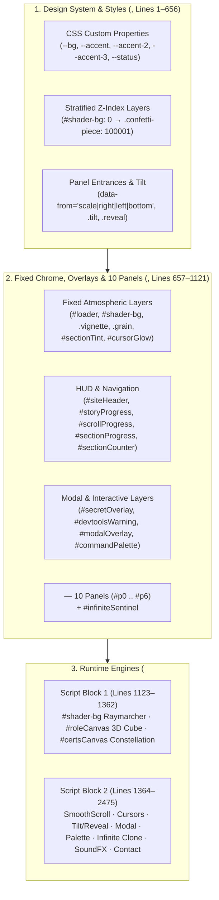

# Portfolio v4.0 — File & Architecture Structure Guide

> **A complete architectural blueprint of how Portfolio v4.0 is structured as a monolithic, zero-dependency, 2,477-line scroll-story application alongside its experimental variants.**

📚 **Documentation Navigation**:
- [← Back to Main README](../README.md)
- [Engineering & Mathematical Concepts (`docs/CONCEPTS.md`)](CONCEPTS.md)
- [Interactive Mechanisms, Functions & Methods (`docs/MECHANISMS.md`)](MECHANISMS.md)

---

## 1. Complete Directory & File Tree

Portfolio v4.0 is packaged without a build step, bundler, or external npm dependencies so `index.html` runs immediately from disk (`file://`) or any static CDN:

```text
My portfolio 4.0/
├── index.html                      # Primary production Scroll-Story Portfolio (2,477 lines)
├── gemini 3.5 falsh lite.html      # Lightweight experimental variant (779 lines, Dark/Light [data-theme])
├── argon gemini.html               # Experimental SPA design iteration archive
├── style.css                       # External stylesheet placeholder (all production CSS is inline in index.html)
├── LICENSE                         # MIT License
├── README.md                       # Visual overview, screenshots, 10-panel tour & quick start
│
├── docs/                           # Modular technical documentation & live screenshots
│   ├── STRUCTURE.md                # (This file) Directory tree, 3-layer HTML layout & z-index stack
│   ├── CONCEPTS.md                 # Deep-dive into 64-step Raymarching SDFs, Web Audio DSP & cloning math
│   ├── MECHANISMS.md               # Function-by-function guide to navigation, modals, palette & Easter eggs
│   └── screenshots/                # Live high-resolution captures of Portfolio v4.0
│       ├── 01-hero-raymarch.png    # Panel 00 Hero + RGB Glitch Typography + SDF Metaballs
│       ├── 02-role-3dcube.png      # Panel 01 Role + Typewriter + 3D WebGL Cube
│       ├── 03-work-projects.png    # Panel 04 Selected Work interactive rows
│       ├── 04-certs-constellation.png # Panel 08 Certifications Constellation Graph + Cards
│       ├── 05-command-palette.png  # 27-Action Fuzzy Command Palette (⌘K / Ctrl+K)
│       └── 06-secret-easteregg.png # Konami Code Secret Room with Typewriter & Confetti
│
├── images/                         # Static visual media assets
│   ├── profile2.jpg                # Developer portrait in Panel 02 About
│   ├── college.jpg                 # Ramco Institute of Technology
│   ├── school.jpg                  # NA Annappa Raja Memorial HSS
│   ├── certificates/               # Certification & internship credentials (csharp, blender, java, dsa, fullstack, responsive, internfs, interngame)
│   └── projects/                   # Project & portfolio screenshots (forest, portfoliov1.1, portfoliov2, portfoliov4, the-back-exit, zyqra)
│
├── videos/                         # Local gameplay & project demonstration clips (.mp4)
└── sounds/                         # Optional audio asset folder (production SFX/music are 100% Web Audio synthesized)
```

---

## 2. Internal Architecture of `index.html` (Monolithic 3-Layer Layout)

`index.html` combines CSS, HTML markup, and two dedicated JavaScript `<script>` blocks into a single portable document:



---

## 3. CSS Design System & Z-Index Stratification (Lines 14–655)

### Color & Typography Tokens (`:root`)
| Token | Value | Purpose |
| :--- | :--- | :--- |
| `--bg` / `--surface-solid` | `#0A0B0F` / `#14161B` | Deep obsidian canvas & opaque overlay cards |
| `--surface` | `rgba(20, 22, 27, 0.6)` | Translucent card backing with `backdrop-filter: blur(10px)` |
| `--text` / `--text-muted` / `--text-faint` | `#F3F1EA` / `#9195A0` / `#5C606B` | Warm ivory display ink & hierarchical text contrast |
| `--accent` / `--accent-2` / `--accent-3` | `#6C63FF` / `#FFB454` / `#00E5FF` | Electric violet primary, solar amber secondary, cyan media indicators |
| `--status` | `#3DDC84` | Emerald online availability & submission success |
| `--font-display` | `'Bricolage Grotesque'` | Expressive hero & section headings |
| `--font-body` / `--font-mono` | `'IBM Plex Sans'` / `'IBM Plex Mono'` | Body copy, telemetry HUD, and keyboard hints |

### Z-Index Stratification Ladder
Every fixed and interactive element obeys a deliberate z-index hierarchy so overlays, cursors, and particle effects never clip behind each other:

| Z-Index | Selector(s) | Layer Role |
| :---: | :--- | :--- |
| `0` | `#shader-bg` | Full-viewport WebGL1 64-step raymarched SDF metaball canvas |
| `1` | `.vignette`, `#sectionTint`, `#cursorGlow` | Edge darkening, per-section tint wash, and blurred 500px/700px pointer glow |
| `2` | `.grain` | Inline SVG `<feTurbulence>` fractal-noise film grain (`mix-blend-mode: overlay`) |
| `3` | `main#story > *` | Scrollable 10-panel story content (enforced via `body > *:not(...)`) |
| `49` | `.section-progress`, `.section-counter`, `.kbd-hint` | Slim left-hand progress bar, `01 — 10 HERO` counter, bottom-right shortcut legend |
| `50` | `.story-progress` | Right-hand vertical dot navigation rail |
| `99` / `100` | `#navMobile` / `#siteHeader` | Fixed top navigation bar (`--header-h: 76px`) and mobile slide drawer |
| `9998` / `9999` | `.swipe-flash` / `.easter-toast`, `.scroll-progress` | Touch swipe hints, Easter egg toast, top tri-gradient reading bar |
| `10000` / `10001` | `#modalOverlay` / `#commandPalette` | Project/cert media briefing modal and `⌘K` fuzzy command palette |
| `99995`–`99999` | `.particle`, `.click-ripple`, `#devtoolsWarning`, `#cursorRing`, `#cursorDot`, `#loader` | Radial burst particles, click waves, anti-DevTools guard, difference-blend cursor, and initial loader |
| `100000` / `100001` | `#secretOverlay` / `.confetti-piece` | Highest-priority Konami Code secret room and Web Animations confetti |

---

## 4. DOM Map: Overlays & The 10 Story Panels (Lines 659–1121)

### Global Chrome & Overlays
- **`#loader`**: Initial splash curtain (`Initializing · Gokula Kumaran`) with a `240px` gradient progress bar (`@keyframes load 1.4s`), automatically dismissed `600ms` after `window.load`.
- **`#secretOverlay`**: Konami Code Easter egg dialog (`// secret_unlocked.txt`) featuring `#secretBody` typewriter prose and 7 favorite developer tags.
- **`#devtoolsWarning`**: Full-screen guard displayed when `window.outerWidth - window.innerWidth > 200` or `outerHeight - innerHeight > 200` while `#secretOverlay` is closed.
- **`#modalOverlay`**: Dynamic detail viewer shared across Education cards, Work rows, Internship cards, and Certification cards.
- **`#commandPalette`**: Keyboard-accessible launcher (`⌘K` / `Ctrl+K`) filtering 27 actions in real time.

### The 10 Story Panels inside `<main class="story" id="story">`
Every section carries a `data-from` directional entrance attribute (`scale`, `right`, `left`, `bottom`) and a `data-tint` RGBA color wash:

| Index | Panel ID | Section | `data-from` | `data-tint` | Key Interactive Elements |
| :---: | :--- | :--- | :--- | :--- | :--- |
| `01` | `#p0` | **Hero** | `scale` | `rgba(108, 99, 255, 0.15)` | `#heroName` (split character mouse-repulsion + RGB glitch), `.magnetic` CTAs |
| `02` | `#p1` | **Role** | `right` | `rgba(255, 180, 84, 0.1)` | `#roleTyped` cyclic typewriter, `#roleCanvas` WebGL1 3D lit cube |
| `03` | `#p2` | **About** | `left` | `rgba(0, 229, 255, 0.08)` | `.about-tags` pills, `.about-visual.tilt` portrait + rotating `GK` badge |
| `04` | `#p2-edu` | **Education** | `bottom` | `rgba(0, 229, 255, 0.08)` | 2 `.cert-card[data-cert]` institutional cards opening `#modalOverlay` |
| `05` | `#p3` | **Work** | `bottom` | `rgba(108, 99, 255, 0.12)` | 6 `.work-row[data-project]` items with tilt, cyan media badges & modal triggers |
| `06` | `#p3-5` | **Metrics** | `scale` | `rgba(61, 220, 132, 0.08)` | 4 `.metric-num[data-count]` counters (`6+`, `6+`, `2+`, `100%`) |
| `07` | `#p3-intern` | **Internships** | `right` | `rgba(255, 180, 84, 0.1)` | 2 `.cert-card[data-cert]` cards (*Skiez Digital* & *Playxoft Studios*) |
| `08` | `#p4` | **Stack** | `left` | `rgba(108, 99, 255, 0.1)` | 4 `.service-item.tilt` cards with bottom gradient reveal bar |
| `09` | `#p5` | **Certs** | `right` | `rgba(0, 229, 255, 0.08)` | `#certsCanvas` 2D interactive graph + 6 `.cert-card[data-cert]` items |
| `10` | `#p6` | **Contact** | `bottom` | `rgba(255, 180, 84, 0.12)` | `#emailLink` (`mailto:`), social links, `#contactForm` inquiry builder |
| `∞` | `#infiniteSentinel` | **Infinite Sentinel** | — | — | `IntersectionObserver` (`rootMargin: 800px`) triggering `clonePanels()` |

---

## 5. Script Execution Organization (Lines 1123–2475)

1. **Script Block 1 (Lines 1123–1362 — Graphics & Canvas Engines)**:
   - `#shader-bg` IIFE: Compiles WebGL1 raymarching fragment shader (`fsSrc`), manages `uTime`, `uRes`, `uMouse`, and `uScroll`, and fades in `.ready` after `300ms`.
   - `#roleCanvas` IIFE: Builds a 24-vertex indexed 3D cube with per-vertex normals and renders it via manual $4\times 4$ rotation and perspective matrix multiplication.
   - `startCertsCanvas(canvas)` & `initAllCertsCanvases()`: Multi-instance 2D canvas loop using `data-certs-init` guards so cloned panels during infinite scroll initialize independent graph instances cleanly.
2. **Script Block 2 (Lines 1364–2475 — UI Systems, Infinite Scroll & Sound Engine)**:
   - Initializes `SmoothScroll`, keyboard/swipe navigators, cursor glow/ring loops, click ripples/particles, `initTilt()`, `initReveals()`, `tintObserver`, clone-safe `updateSectionProgress()`, Konami code `activateEasterEgg()`, hero letter splitter, role typewriter, `openModal()`, 27-item `commandPalette`, `clonePanels()`, and the 5-layer `window.SoundFX` Web Audio engine.
